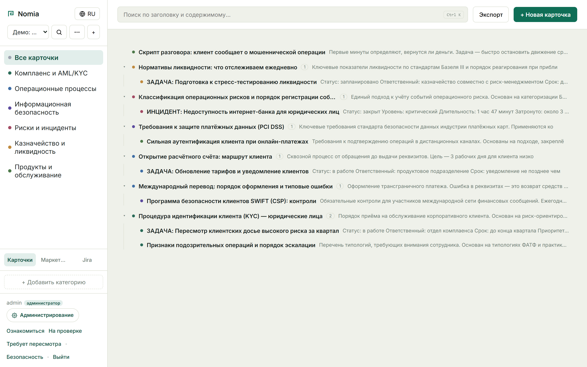
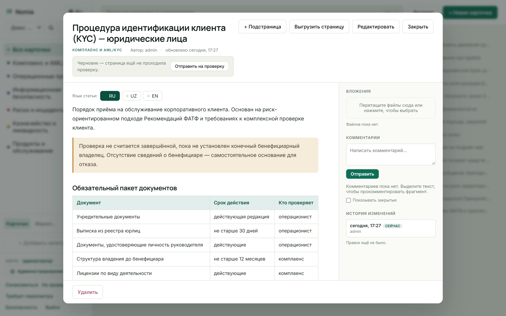
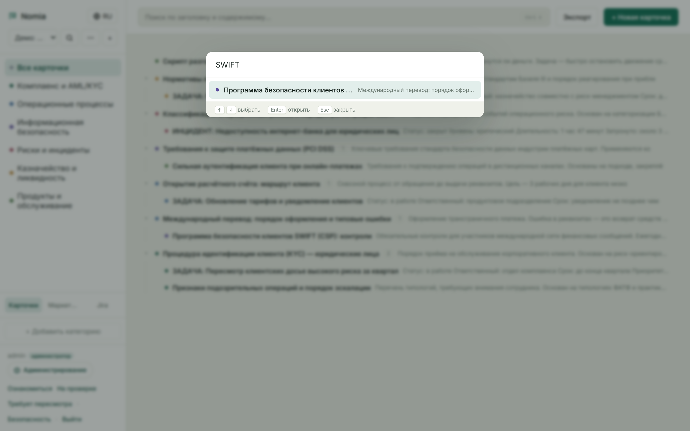
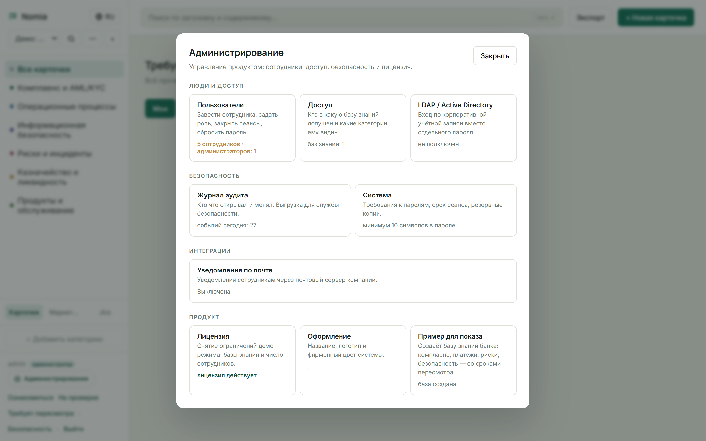
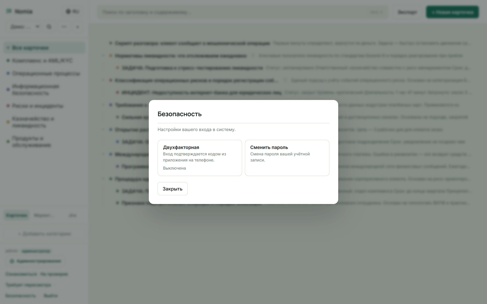
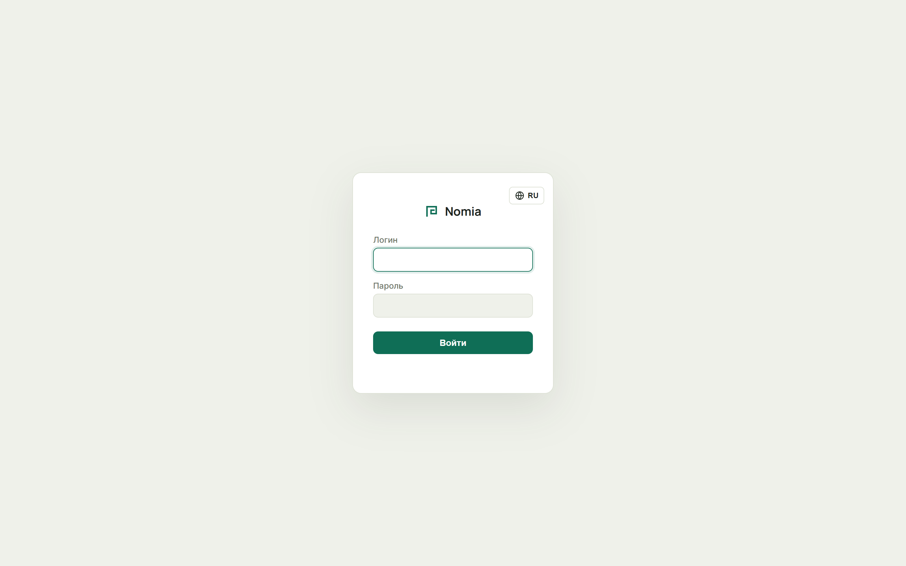
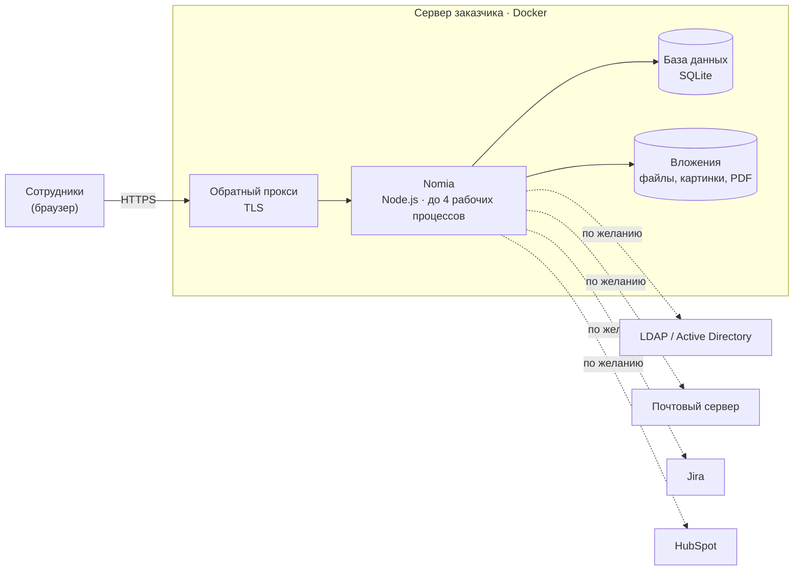

# Nomia — база знаний компании, которая работает на её собственном сервере

**Nomia** — это корпоративная база знаний: регламенты, инструкции, процессы и ответы на частые вопросы в одном месте, с поиском, правами доступа и контролем ознакомления.

Главное отличие от облачных сервисов вроде Notion и Confluence: **Nomia ставится внутри инфраструктуры заказчика и не отправляет данные наружу.** Продукт рассчитан на компании, которым облако закрыто требованиями регулятора или собственной службы безопасности: банки, госсектор, промышленность.

> Это витрина продукта. Исходный код в репозитории не публикуется.
> Живая демонстрация возможна на созвоне.

---

## Как выглядит продукт

**База знаний.** Документы разложены по категориям и вложены друг в друга деревом. На скриншоте демо-база банка: комплаенс, AML/KYC, операционные риски, PCI DSS, SWIFT.

**Документ.** Текст с таблицами и выделенными блоками, вложения, комментарии к фрагментам текста, история изменений, версии на трёх языках, отправка на проверку.

**Быстрый поиск** по всей базе (Ctrl + K).

**Администрирование:** сотрудники, доступ к базам, вход через корпоративный каталог, журнал аудита, политика паролей, резервные копии, лицензия, фирменное оформление.

**Безопасность входа:** двухфакторная аутентификация через приложение на телефоне.

**Вход в систему.**

---

## Что умеет

**Работа с документами**
- Дерево страниц любой вложенности, категории с цветовой маркировкой
- Вложения: картинки, PDF (открываются прямо на странице), любые файлы
- История версий с возможностью отката
- Комментарии к выделенному фрагменту текста
- Импорт из Word: документ на 200 страниц режется на разделы по заголовкам, картинки и печати переносятся
- Выгрузка в Word, PDF и Markdown

**Контроль и соответствие требованиям**
- Согласование: черновик → на проверке → опубликовано
- Ознакомление под подпись: сотрудник подтверждает, что прочитал документ; система фиксирует время, адрес и язык, на котором он читал
- Отчёт для проверяющего одной кнопкой: кто, что и когда прочитал, с местом для подписи ответственного
- Сроки пересмотра документов и раздел «Требует пересмотра»
- Уведомления по почте через почтовый сервер компании

**Языки**
- Интерфейс на русском, узбекском (латиница) и английском
- Переводы статей с контролем актуальности: если оригинал изменили, устаревший перевод не показывается

**Интеграции** (подключаются по желанию)
- LDAP / Active Directory: вход по корпоративной учётной записи
- Jira (Cloud и Server): задачи сотрудника рядом с базой знаний
- HubSpot: маркетинговые кампании
- Почтовый сервер компании (SMTP)

---

## Архитектура

- **Поставка:** Docker-образ и один файл конфигурации. Отдельная конфигурация для банка: TLS, вынесенный ключ подписи сессий, резервное копирование по расписанию, сбор журналов.
- **Без внешних обращений:** шрифты, скрипты и стили лежат внутри продукта, никаких CDN, Google Fonts и автоперевода. Наружу Nomia ходит только в те системы, которые подключил администратор.
- **Лицензирование офлайн:** лицензия проверяется по цифровой подписи (Ed25519) без связи с сервером разработчика. Без лицензии продукт работает в демо-режиме.
- **Нагрузка:** на сервере с 4 ядрами рассчитан на 200–300 одновременно работающих сотрудников. В нагрузочном тесте при 100 одновременных пользователях: 610 запросов чтения и 337 созданий страниц в секунду.

---

## Безопасность

- Роли и права: администратор, участник и отдельные права, которые можно выдать без полных прав администратора
- Разграничение доступа между базами знаний и по категориям внутри базы
- Двухфакторная аутентификация, политика паролей, срок жизни сессий, отзыв конкретной сессии
- Журнал аудита всех значимых действий с выгрузкой в CSV
- Токены интеграций зашифрованы (AES-256-GCM)
- Защита от подбора пароля, от внедрения скриптов через текст и от обращений во внутреннюю сеть через интеграции

Продукт прошёл **более пяти раундов аудита безопасности с реальными попытками атак**. Найденные уязвимости закрыты, каждая закреплена отдельной автоматической проверкой.

**Автоматических проверок: 1 073** в основном наборе, плюс 82 по почте и 47 по Jira. Отдельно проверены обновление поверх работающей базы, восстановление после аварийного отключения и работа в нескольких процессах.

---

## Как сделан продукт

Nomia создана **с помощью ИИ**: я не программист, весь код, тесты и аудиты безопасности писал Claude (Anthropic).

Моя роль была ролью заказчика и архитектора решения:
- **Постановка задачи:** для кого продукт, какую проблему решает, почему облачные аналоги не подходят банку
- **Требования:** работа внутри сервера клиента, защита данных, лицензирование, роли, интеграции
- **Приоритеты:** что делать сейчас и что потом, исходя из ценности для покупателя
- **Приёмка:** проверка на реальной машине, поиск ошибок в живом использовании, решения по спорным местам

Путь от прототипа в одном HTML-файле до продукта уровня банковского внедрения занял несколько месяцев.

---

## Честно о текущих ограничениях

- Пилота у реального заказчика ещё не было
- Свыше 400 одновременных пользователей нужен переход с SQLite на PostgreSQL
- Мобильная вёрстка требует доработки
- Квалифицированной электронной подписи нет: ознакомление подтверждается в системе, без сертификата

---

*Автор: Алексей Костиков, Ташкент.*
